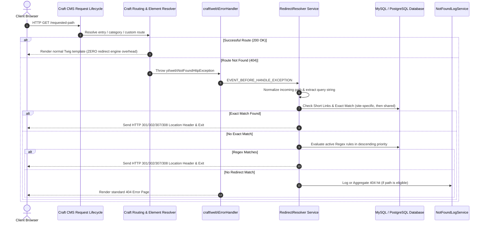

# Technical Architecture — SEO Redirect Manager for Craft CMS 5

## 1. Executive Summary & Design Principles

**SEO Redirect Manager** is designed to provide high-performance, deterministic URL redirection, 404 monitoring, automatic link repair, and SEO diagnostics for Craft CMS 5 sites.

### Non-Negotiable Core Principles
1. **Zero Impact on Successful Requests**: Only requests that genuinely fail to resolve in Craft (HTTP 404s) enter the redirect resolution engine. Normal 200 OK pages execute with zero additional database lookups or regex checks.
2. **Correct HTTP Semantics**: Strict compliance with RFC 9110 for status codes (`301 Moved Permanently`, `302 Found`, `307 Temporary Redirect`, `308 Permanent Redirect`). Location headers are validated and encoded.
3. **Craft Cloud & Ephemeral Filesystem Compatibility**: Entirely stateless. All configuration, redirect rules, short links, and 404 logs reside in Craft's database (MySQL/PostgreSQL). Zero dependency on local disk persistence, custom daemons, or server-level `.htaccess` / Nginx rewrite access.
4. **Defense in Depth**: Robust defenses against open redirect vulnerabilities, HTTP header injection, server-side request forgery (SSRF), spreadsheet formula injection in CSV exports, and catastrophic regex backtracking (ReDoS).
5. **Multi-Site Isolation & Inheritance**: First-class multi-site support where redirects can be strictly site-specific or shared across all sites with deterministic precedence.

---

## 2. Request Lifecycle Integration



### Why `ErrorHandler::EVENT_BEFORE_HANDLE_EXCEPTION`?
Rather than injecting a global middleware or `Application::EVENT_BEFORE_REQUEST` filter that inspects every single asset, entry, and API request on the website, SEO Redirect Manager hooks exclusively into:
```php
Event::on(
    ErrorHandler::class,
    ErrorHandler::EVENT_BEFORE_HANDLE_EXCEPTION,
    function(ExceptionEvent $event) { ... }
);
```
When Craft successfully resolves an entry, category, asset, or custom route, this event is **never fired**. Normal traffic executes at peak native speed. Only when a request triggers a `404 NotFoundHttpException` does our resolver kick in to find a match.

---

## 3. Matching Precedence & Resolution Logic

When an incoming request triggers a 404, matching occurs in the following deterministic sequence:

1. **Short Links**:
   - Check if the path matches the configured short link prefix (e.g., `/go/{slug}`).
   - Look up by `{slug}` for current site, then shared.
   - If matched, increment counter and send redirect.
2. **Exact Redirect Rules (Site-Specific)**:
   - Query `{{%seoredirect_redirects}}` where `sourceNormalized = :path` and `siteId = :currentSiteId` and `enabled = 1` and `matchType = 'exact'`.
3. **Exact Redirect Rules (Shared / All Sites)**:
   - Query `{{%seoredirect_redirects}}` where `sourceNormalized = :path` and `siteId IS NULL` and `enabled = 1` and `matchType = 'exact'`.
4. **Regular Expression Rules**:
   - Query all enabled regex rules for the current site and shared sites, ordered by `priority DESC, id ASC`.
   - Test each expression using PCRE with preg execution limits to protect against catastrophic backtracking.
   - Perform backreference substitutions (`$1`, `$2`, etc.) in the target destination.

### Loop Detection at Runtime
Before dispatching any redirect, the resolver maintains a breadcrumb trail in the request context:
- If `targetUrl === incomingUrl`, the redirect is recognized as a direct self-loop and suppressed.
- Maximum chain resolution depth is capped at 5 hops to prevent recursive server loops.

---

## 4. Query-String Policies

Each redirect rule specifies one of three deterministic query policies:
1. `preserve`: The original query parameters from the request are appended to the destination. If the destination already contains parameters, they are merged.
2. `exact`: The request query string must match the rule's defined query string exactly for the rule to trigger.
3. `ignore`: Discard any incoming query parameters; redirect solely to the clean destination URL.

---

## 5. Automatic Redirects on Content URI Changes

When content editors modify an entry's slug or move an entry within a Structure section:
1. Hook into `Entry::EVENT_AFTER_SAVE`.
2. Inspect if the entry is a draft or revision: if so, **skip** (drafts and revisions must never pollute public redirects).
3. If the element is live and its previous URI (`$entry->getOldAttribute('uri')` or previous element snapshot) differs from its new URI:
   - Verify that an identical redirect does not already exist.
   - Verify that the old URI is not a redirect loop.
   - Automatically insert a 301 redirect from the old URI to the new URI with `isAuto = true` and `elementId = $entry->id`.
   - Log the event in `{{%seoredirect_audit}}`.

---

## 6. 404 Log Aggregation & Privacy Protection

### Bounded Storage & Deduplication
To prevent database bloat from automated vulnerability scanners and web crawlers:
- 404 records are deduplicated by `(siteId, pathNormalized)`.
- Subsequent hits to the same missing path increment `hitCount` and update `lastSeen`, rather than creating new table rows.

### Security & Privacy Filtering
- Ignored patterns: Requests for common asset extensions (`.map`, `.woff`, `.ico`), health checks (`/healthz`, `/ping`), and administrative routes (`/admin/*`) are filtered out based on configurable settings.
- Sensitive query strings (passwords, auth tokens, session IDs) are stripped before saving paths.
- IP addresses are not stored in 404 logs; referrers and user agents are sanitized.

### Scheduled Retention Cleanup
A Craft console command (`craft seo-redirect-manager/cleanup/logs`) and automated queue job (`CleanupNotFoundLogsJob`) prune 404 records older than the configured retention period (default: 30 days).

---

## 7. Craft Cloud & Hosting-Dependent Considerations

| Feature | Craft Cloud Compatibility | Implementation Strategy |
|---|---|---|
| **Redirect Rules** | ✅ 100% Compatible | Stored in Craft database (MySQL / PostgreSQL) via ActiveRecord. |
| **Short Links** | ✅ 100% Compatible | Stored in database, resolved via 404 lifecycle or site route. |
| **404 Logging** | ✅ 100% Compatible | Aggregated in database, zero disk writes. |
| **CSV Import / Export** | ✅ 100% Compatible | Streams via PHP in-memory temp (`php://temp`), zero persistent filesystem writes. |
| **Maintenance / Cleanup** | ✅ 100% Compatible | Runs via standard Craft Queue jobs and CLI console commands. |
| **External Destination Checks** | ⚠️ Network Dependent | Optional outbound HTTP checks feature SSRF protection (loopback/private IP blocking) and configurable timeouts. If outbound network is restricted by hosting firewalls, internal route checks remain fully functional. |
